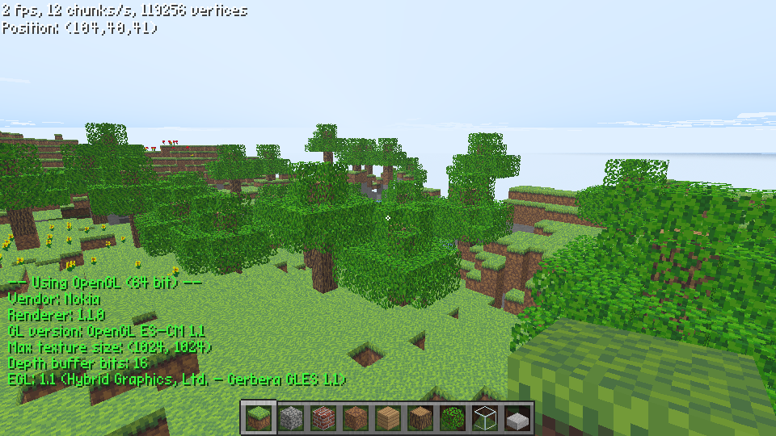
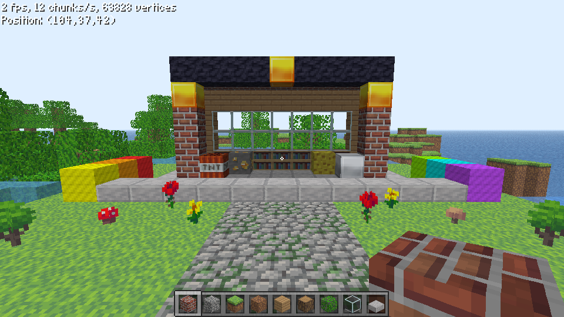
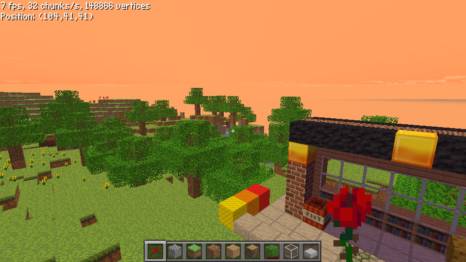

# Gerbera GLES1 RE

Complete C99 source reconstruction of `libGLES_CM.dll` - the OpenGL ES 1.1
Common Profile + EGL 1.1 software driver shipped on Symbian devices (Nokia /
Hybrid Graphics "Gerbera" stack, cross-referenced across both the WINSCW x86
emulator PE DLL and the EKA2 ARM32 device image `libgles_cm.dll.epoc`).

What is in this repository:

| path              | contents                                                          |
|-------------------|-------------------------------------------------------------------|
| `docs/`           | x86 (`libGLES_CM.dll`) + ARM (`libgles_cm.dll.epoc`) binaries & decompilations (input) |
| `tools/`          | scripts that split and attribute the decompilation                |
| `generated/`      | tool output (fragments + manifest), regenerable, not committed    |
| `src/`            | complete C99 reconstruction (`hg`, `imath`, `gerbera/core`, `grr`, `hc`, `api_opengl`, `egl`) |
| `symbian/`        | native Symbian OS v9.x (EKA2 / S60 3rd Ed+) ARMv5 build (`libgles_cm.dll` + `libgles_cm.dso`) |
| `tests/`          | automated unit & integration test suites (`test_hg`, `test_imath`, `test_core`, `test_opengl`, `test_egl`) |
| `demo/`           | end-to-end **ClassiCube** OpenGL ES 1.1 + EGL 1.1 showcase & 6 captured 960x540 screenshots |
| `AGENTS.md`       | how to work on this repo (agent guide)                            |
| `PROGRESS.md`     | module-by-module reconstruction log & verification status         |
| `docs/analysis.md`| reverse engineering findings: original tree, module map, artifacts|

Build and test:

```
make test      # builds build/libgerbera.a (65 .c files) and runs all 5 test suites
make win32     # cross-compiles Win32 (i386 PE32) libGLES_CM.dll + ClassiCube.exe in demo/win32/
make symbian   # cross-compiles Symbian OS v9.x (EKA2 ARMv5) libgles_cm.dll + libgles_cm.dso in symbian/out/
make symbian-rgb565  # RGB565 variant in symbian/out/rgb565/ (EColor64K window back buffers)
```

Status: **100% of all modules (`hg`, `imath`, `gerbera/core`, `grr`, `hc`,
`api_opengl`, `egl`, and `egl_symbian` hosted backend) and 177 / 177 non-CRT PE
ordinal exports of `libGLES_CM.dll` are ported and verified**:
- `hg`: 295 checks
- `imath`: 311 checks
- `gerbera/core` + `grr` + `hc` JIT compiler (x86 & ARM32 backends): 2,327 checks
- `gerbera/api_opengl` (158 `gl*` OpenGL ES 1.1 + OES entry points in `<GLES/gl.h>`): 414 checks
- `gerbera/egl` + `eglSymbian` (27 `egl*` EGL 1.1 entry points in `<GLES/egl.h>` & `<EGL/egl.h>`, incl. render-to-texture): 1,075 checks
- Total: **4,422 / 4,422 checks passing**, `0` failures, `0` compiler warnings, `0` AddressSanitizer / LeakSanitizer errors across 66 `.c` files. See `PROGRESS.md`.

## Real-World OpenGL ES 1.1 + EGL 1.1 Showcase (`demo/`)

[**ClassiCube**](https://github.com/ClassiCube/ClassiCube) running its native OpenGL ES 1.1 + EGL 1.1 renderer linked solely against `build/libgerbera.a` (zero system GL/Mesa/SDL libraries). See [`demo/README.md`](demo/README.md) and `./demo/build_and_capture.sh` for all 6 scenes:

| Overworld & GLES 1.1 HUD | Block Showcase Pavilion | Sunset & `GL_LINEAR` Fog |
|--------------------------|-------------------------|--------------------------|
|  |  |  |

## Alternative native GLES implementations

- [PixelFlinger](pixelflinger/README.md): Android software renderer with
  ARMv5TE JIT and C++ fallback.
- [Vincent](vincent/README.md): pinned mcejp/vincent-es portable fixed-point
  renderer with a native EKA2 window/pbuffer adapter; legacy JIT disabled.
  Build with `./vincent/build_symbian.sh`; packaged SDK is under `vincent/out/`.

These are alternatives to Gerbera. They intentionally share the system
`libgles_cm.dll` name/UIDs and must not be installed simultaneously. See each
port's validation limits and deployment cautions before using it on a device.
