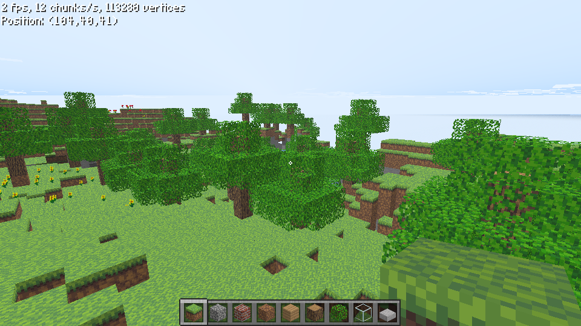
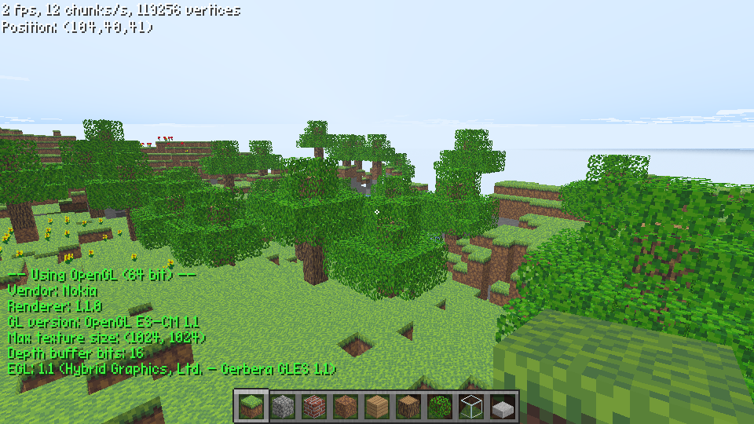
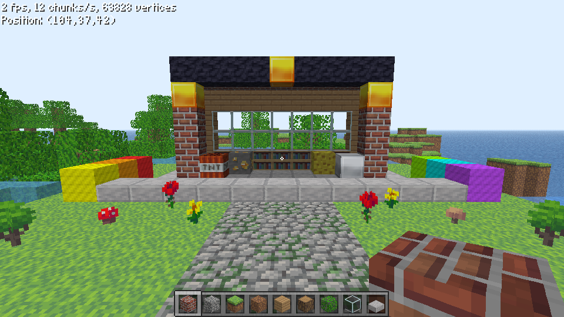
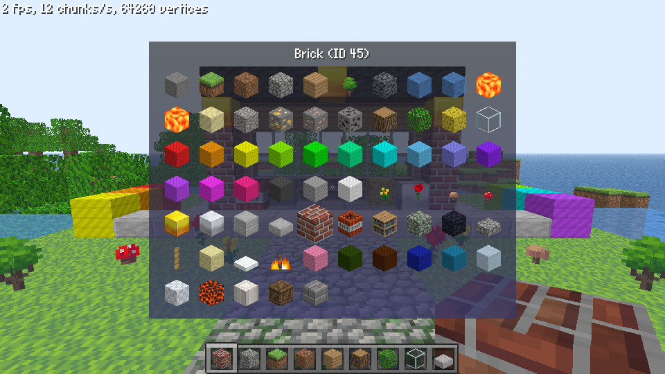
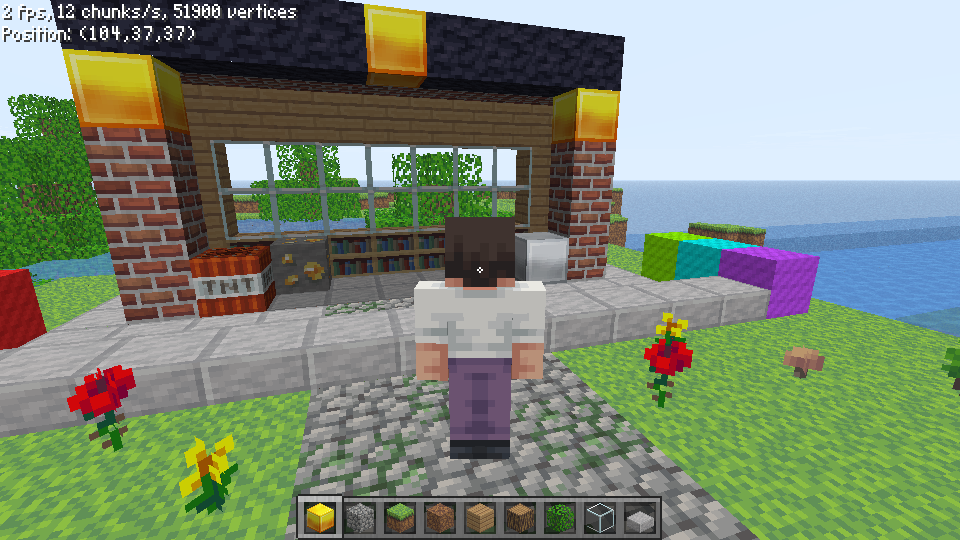
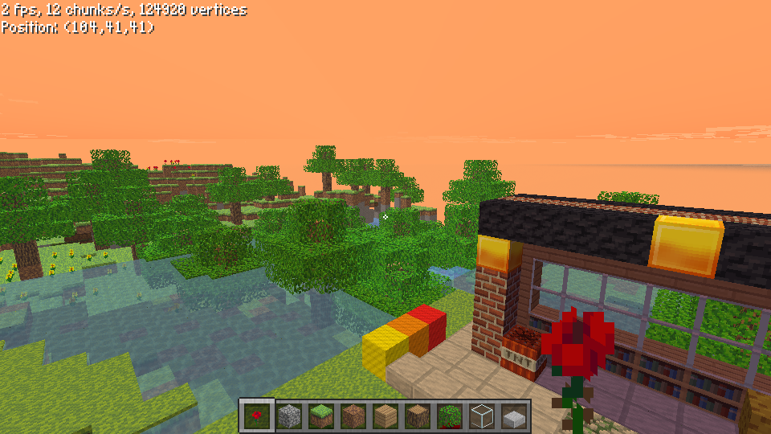

# ClassiCube on Gerbera OpenGL ES 1.1 + EGL 1.1

End-to-end 3D game showcase running [**ClassiCube**](https://github.com/ClassiCube/ClassiCube) (pure C99 Minecraft Classic-compatible voxel engine) compiled with its native OpenGL ES 1.1 backend (`CC_GFX_BACKEND_GL1` + `CC_BUILD_GLES` + `CC_BUILD_EGL`) and linked **solely against our reconstructed `build/libgerbera.a`** — zero system OpenGL, Mesa, GLX, or SDL libraries linked.

Every pixel in all six `960x540` screenshots below is rendered in software by the reconstructed Nokia / Hybrid Graphics `libGLES_CM.dll` OpenGL ES-CM 1.1 + EGL 1.1 stack (`eglGetDisplay`, `eglInitialize`, `eglChooseConfig`, `eglCreateWindowSurface`, `eglCreateContext`, `eglMakeCurrent`, `glGenBuffers`/`glBindBuffer`/`glBufferData` VBOs & IBOs, `glLoadMatrixf` perspective & hierarchical modelview stacks, `glTexImage2D` mipmapped `GL_RGBA` terrain/font/skin atlases, `GL_PERSPECTIVE_CORRECTION_HINT = GL_NICEST` adaptive perspective subdivision, Sutherland-Hodgman frustum clipping, `GL_DEPTH_TEST(GL_LEQUAL)` 16-bit depth buffering, `GL_ALPHA_TEST(GL_GREATER, 0.5f)` vegetation & UI cutouts, `GL_BLEND(GL_SRC_ALPHA, GL_ONE_MINUS_SRC_ALPHA)` water/glass/GUI compositing, `GL_FOG(GL_LINEAR)` horizon fog, and `glReadPixels` framebuffer capture).

## Captured OpenGL ES 1.1 Screenshots (`960x540`)

### 1. Procedural Overworld Landscape (`01_overworld_landscape.png`)
128x64x128 procedural Notchy world (`119,280` vertices across chunk VBOs) featuring grass hills, oak trees, wild dandelions & red mushrooms, sky/cloud dome, horizon fog, 3D held grass block, and isometric 3D block hotbar.



### 2. Live OpenGL ES-CM 1.1 & EGL 1.1 Driver Info HUD (`02_gles1_gpuinfo_hud.png`)
ClassiCube's `/client gpuinfo` command querying `glGetString(GL_VENDOR / GL_RENDERER / GL_VERSION)`, `glGetIntegerv(GL_MAX_TEXTURE_SIZE / GL_DEPTH_BITS)`, and `eglQueryString(EGL_VERSION / EGL_VENDOR)` directly from `libgerbera.a` (`Vendor: Nokia`, `Renderer: 1.1.0`, `GL version: OpenGL ES-CM 1.1`, `Max texture size: (1024, 1024)`, `Depth buffer bits: 16`, `EGL: 1.1 (Hybrid Graphics, Ltd.)`).



### 3. Block Showcase Pavilion & Flora Garden (`03_block_showcase_pavilion.png`)
Custom-built coastal pavilion exercising opaque textured blocks (cobblestone, mossy cobblestone, stone slabs, brick, gold, obsidian, wood planks, bookshelves, TNT, gold ore, sponge, iron, rainbow wool), `GL_ALPHA_TEST` cross-quad flora (roses, dandelions, red & brown mushrooms, oak saplings), and `GL_BLEND` glass windows overlooking trees and ocean.



### 4. Isometric 3D Block Inventory GUI (`04_block_inventory_gui.png`)
Semi-transparent `GL_BLEND` inventory modal rendering all 65 ClassiCube blocks via isometric 3D OpenGL ES 1.1 VBO draw calls (`Brick (ID 45)` hovered) composited over the live 3D pavilion scene.



### 5. Third-Person 3D Player Character (`05_third_person_player.png`)
Third-person camera rendering the articulated 3D humanoid player model (`glPushMatrix` / `glPopMatrix` / `glTranslatef` / `glRotatef` hierarchical modelview matrix stack + alpha-blended circular drop shadow) standing on the cobblestone walkway.



### 6. Golden-Hour Sunset & `GL_LINEAR` Horizon Fog (`06_sunset_fog_atmosphere.png`)
Sunset environment colors (`Env_SetSkyCol`, `Env_SetFogCol`, `Env_SetCloudsCol`, `Env_SetSunCol`, `Env_SetShadowCol`), translucent lagoon water (`GL_BLEND`) revealing submerged terrain underneath, held 3D rose, and `GL_FOG` (`GL_LINEAR`) atmospheric horizon fade (`124,920` vertices).



## Reproducing in One Command

```bash
./demo/build_and_capture.sh
```

| File | Description |
|------|-------------|
| `demo/Window_Gerbera.c` | Self-contained 960x540 Gerbera EGL 1.1 (`NativeWindowType` -> `GerberaWindowSurfaceDesc`) window/context backend + automated 6-scene camera & world showcase driver |
| `demo/classicube_gles1.patch` | Minimal 28-line patch enabling ClassiCube's Symbian OpenGL ES 1.1 VBO + `GL_RGBA` path under generic `CC_BUILD_GLES` and deterministic `CC_SEED` world generation |
| `demo/build_and_capture.sh` | Builds `build/libgerbera.a`, clones/patches ClassiCube, compiles `ClassiCube` against `libgerbera.a`, and captures `01`..`06` PNGs |

## Real-World Driver Fixes Uncovered by 3D Engine Bring-Up

Running a full 3D voxel engine with arbitrary `glLoadMatrixf` camera matrices, dynamic VBO streaming, multi-plane frustum clipping, and recursive perspective tessellation uncovered and resolved 7 subtle bugs in the reconstructed driver (all cross-verified against `docs/libGLES_CM.dll.c` and covered by unit & ASan regression tests in `tests/test_opengl.c`):

1. **`IFVector4_dp4l_fast` return word order (`src/imath/IMatrix4.c:796`, DLL `55248`)**: Swapped `hgSet64(maxE, m)` -> `hgSet64(m, maxE)` (`maxE` belongs in bits `[31:0]`, `m` in `[63:32]`), fixing `oglLoadMatrix` non-uniform matrix classification (`transformType = 15`) when loading arbitrary `glLoadMatrixf` projection/modelview matrices.
2. **`IVertexTransform_mulfv4` exponent renormalization (`src/imath/IMatrix4.c:1466`, DLL `55665`)**: Fixed `maxE + 2 - (clz + 127)` (was `clz - 1 + 127`, off by `252` in IEEE-754 biased exponent space), fixing clip-space vertex transformation under general `4x4` perspective matrices.
3. **`glBufferData` active vertex-array pointer refresh (`src/gerbera/api_opengl/oglApi.c:2806`)**: Refreshes `ctx->vertexArray[i].data` whenever `glBufferData(GL_ARRAY_BUFFER, ...)` reallocates a buffer object already bound to a vertex array slot (preventing stale pointers when engines re-upload dynamic VBOs without re-issuing `glVertexPointer`).
4. **`enum GR_FUNC_e` compare-function table order (`src/include/gerbera/grState.h:456`, DLL `18330-18424`)**: Matched `GL_NEVER - 512 .. GL_ALWAYS - 512` (`0=NEVER, 1=LESS, 2=EQUAL, 3=LEQUAL, 4=GREATER, 5=NOTEQUAL, 6=GEQUAL, 7=ALWAYS`), fixing `glDepthFunc(GL_LEQUAL)` and `glAlphaFunc(GL_GREATER, 0.5f)`.
5. **64-bit pixel-pipeline fog factor polarity (`src/gerbera/grPixelPipeline.c:537`)**: `grApplyFogLINEAR`/`EXP`/`EXP2` and `state->fogAtZero` encode `1 - f` (`0` = 0% fog at `fogStart`, `0xFFFF` = 100% fog at `fogEnd`); updated `grExecutePixelPipeline64` to blend `(255 - fog8) * frag + fog8 * fogColor` with `fogAtZero` fallback.
6. **`grClipPrimitive` back-facing fan `fan[0]` gradient interpolation (`src/gerbera/grClipper.c:561,577`, DLL `31384,31418`)**: Initialized `k = 0` outside the fan-triangle loop with `for (; k < j + 3; ++k)` so clipped intersection vertex `fan[0]` has its color/UV/fog gradients interpolated before `grTriangleTessellator` / `grDrawClippedTriangle` when `triSide == GR_SIDE_BACK` (`GL_CULL_FACE` disabled).
7. **`grClipper` multi-plane polygon distance array size (`src/gerbera/grClipper.c:290`)**: Sized `dot[GR_MAX_CLIPPER_VERTICES]` (`15`) instead of `dot[3]` so triangles clipped against two or more frustum/user planes (producing 4..15 polygon vertices) never overflow `dot` on the stack.
